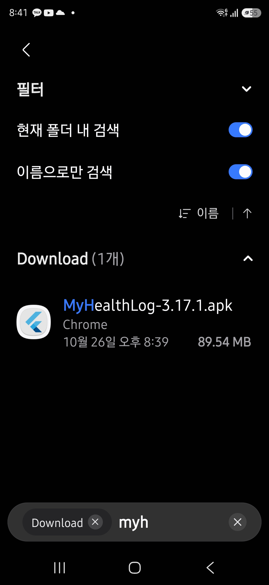
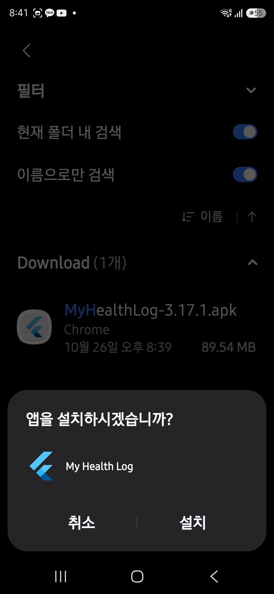
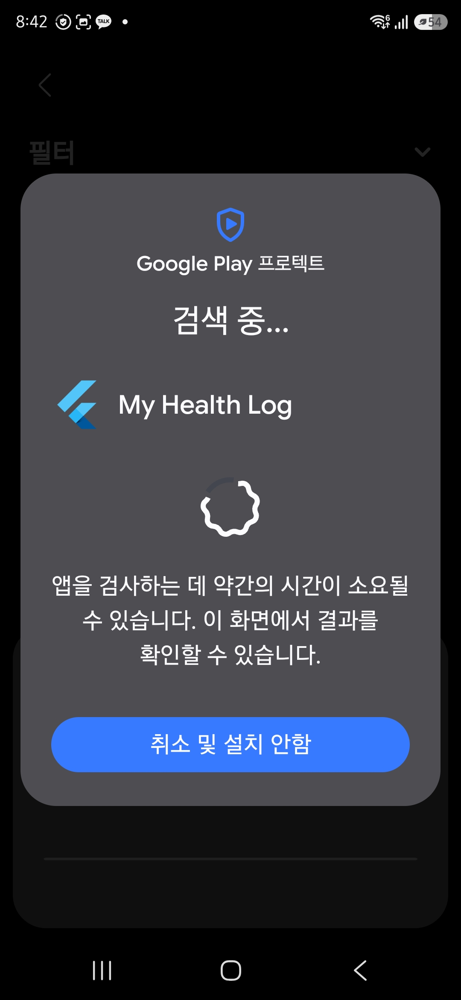
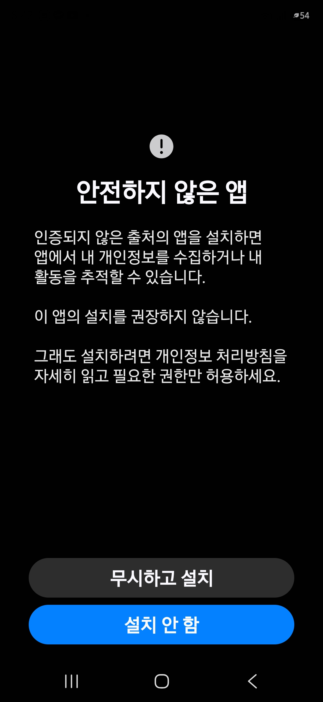
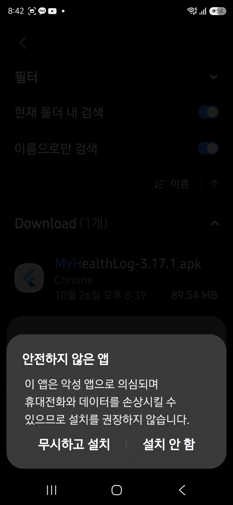
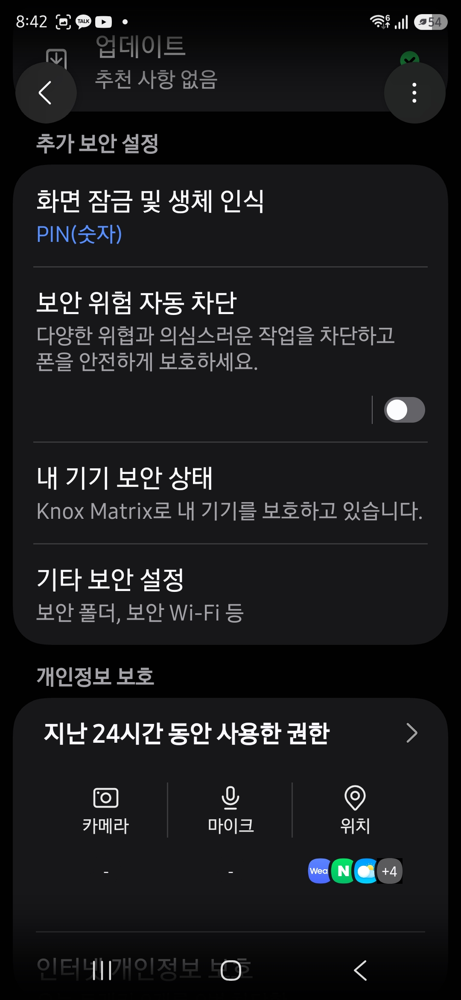

# My Health Log 실제 화면 안드로이드 설치 안내

최신 파일: `MyHealthLog-3.18.3+60-update.apk` · [다운로드](https://github.com/mydunalove-sena/my-health-log-releases/releases/download/v3.18.3/MyHealthLog-3.18.3%2B60-update.apk) · [최신 버전](https://github.com/mydunalove-sena/my-health-log-releases/releases/latest)

사용자 제공 실제 화면 6장을 화면 내용에 맞춰 설치 순서로 배치했습니다. 사진 속 3.17.1 파일명과 날짜는 이전 버전 예시이며, 기기에 따라 화면 모양과 표시 순서가 다를 수 있습니다.

## 1. 먼저 확인: 실제 화면으로 따라 하는 설치 안내

- 최신 설치 파일은 MyHealthLog-3.18.3+60-update.apk입니다.
- 이 안내서는 직접 설치할 때 촬영한 실제 갤럭시 화면 6장을 사용합니다.
- 사진 속 3.17.1 파일명과 날짜는 이전 버전 예시입니다. 실제로는 위의 최신 파일을 받으세요.
- 휴대폰과 Android 버전에 따라 화면 모양과 순서는 달라질 수 있습니다.
- 처음 설치하면 3쪽부터, 기존 사용자는 2쪽에서 먼저 백업하세요.
- 캡처를 제공한 갤럭시에서는 7·8쪽의 절차를 거쳐야 설치가 진행됐습니다. 같은 화면에서 막히면 해당 쪽을 확인하세요.

## 2. 기존 사용자: 기존 앱을 지우지 말고 백업하세요

- 기존 My Health Log 앱을 열고 아래의 ‘홈’을 누르세요.
- 위쪽 ‘데이터 관리’ → ‘백업 파일 저장’을 누르세요.
- 파일 저장 창에서 ‘저장’을 누른 뒤 새 APK를 설치하세요.
- 이미 앱이 있으면 ‘업데이트’로 표시될 수 있습니다.
- 백업 파일에는 개인 건강 기록이 들어 있으니 본인만 보관하세요.

## 3. 설치 1단계: 다운로드한 APK 파일을 여세요

- 휴대폰의 ‘내 파일’ 또는 Files 앱에서 ‘다운로드’를 여세요.
- 이번에 받은 .apk 파일을 누르세요.
- 사진은 이전 3.17.1 예시입니다. 최신 파일명은 첫 쪽과 배포 페이지에서 확인하세요.

## 4. 설치 2단계: 앱 이름을 확인하고 설치하세요

- 앱 이름이 My Health Log인지 확인하세요.
- 이 화면이면 오른쪽 아래 ‘설치’를 누르세요. 기존 사용자는 ‘업데이트’로 표시될 수 있습니다.
- 기존 앱이나 기록을 삭제할 필요는 없습니다.

## 5. 설치 3단계: 보안 검사 결과를 기다리세요

- ‘검색 중…’은 Play 프로텍트가 앱을 검사하는 화면입니다.
- 검사가 끝날 때까지 잠시 기다리고 화면에 나온 결과를 확인하세요.
- 위험 경고가 나오면 다음 두 쪽에서 같은 화면을 찾아 안내를 확인하세요.

## 6. 경고가 뜬 경우만: 출처 경고의 내용을 확인하세요

- 이 화면은 모든 기기에서 나타나는 필수 단계가 아닙니다.
- ‘인증되지 않은 출처’ 경고가 보이면 배포 주소와 파일을 먼저 확인하세요.
- 출처를 확인하고 설치하기로 결정했다면 ‘무시하고 설치’를 누르세요. 확신이 없으면 ‘설치 안 함’을 누르세요.

## 7. 차단 시 진행 1: 경고를 확인하고 설치를 진행하세요

- 사용자 확인 갤럭시에서는 이 화면에서 설치를 계속 허용해야 다음으로 진행됐습니다.
- 배포 주소와 파일명을 확인하고 설치하기로 결정했다면 왼쪽 ‘무시하고 설치’를 누르세요.
- 위험 경고를 무시하는 선택입니다. 출처를 확인할 수 없거나 확신이 없으면 ‘설치 안 함’을 누르세요.

## 8. 차단 시 진행 2: 자동 차단으로 막히면 설정을 바꾸세요

- ‘설정 → 보안 및 개인정보 보호 → 보안 위험 자동 차단’을 여세요.
- 자동 차단으로 설치가 막혔다면 파일 출처를 확인한 뒤 스위치를 꺼짐으로 바꾸세요.
- ‘내 파일’로 돌아가 APK를 다시 열고 설치하세요. 사진은 꺼짐 상태입니다.
- 설치 후 이 설정을 다시 켜세요. Google Play 프로텍트는 끄지 않습니다.

## 9. 설치가 끝나면: 열기 후 기존 기록을 확인하세요

- 설치가 끝난 화면에서 ‘열기’를 누르세요.
- 다음부터는 My Health Log 앱 아이콘으로 실행하세요.
- 기존 사용자는 예전 기록과 검사 선택이 보이는지 확인하세요.
- 사진 입력 등 기능을 사용할 때 요청되는 권한을 확인하고 필요한 권한만 허용하세요.
- 설치 중 보안 위험 자동 차단을 껐다면 다시 켜세요.

## 10. 도움이 필요하면: 앱을 지우기 전에 문의하세요

- 파일이 안 보여요 → ‘내 파일’의 ‘다운로드’를 다시 확인하세요.
- 설치되지 않아요 → 오류 화면과 받은 파일 버전을 제작자에게 알려주세요.
- 이전 기록이 안 보여요 → 앱과 백업 파일을 보관한 상태로 문의하세요.
- 위험 경고로 막혀요 → 7쪽의 진행 방법을 확인하세요. 출처를 확인할 수 없으면 설치를 멈추고 문의하세요.

## 공식 참고 안내

- [Google Play 프로텍트](https://support.google.com/googleplay/answer/2812853?hl=ko)
- [삼성 앱 설치 및 차단 안내](https://www.samsung.com/us/support/troubleshoot/TSG10001914/)
