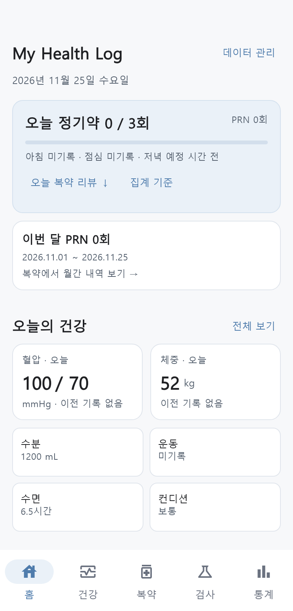
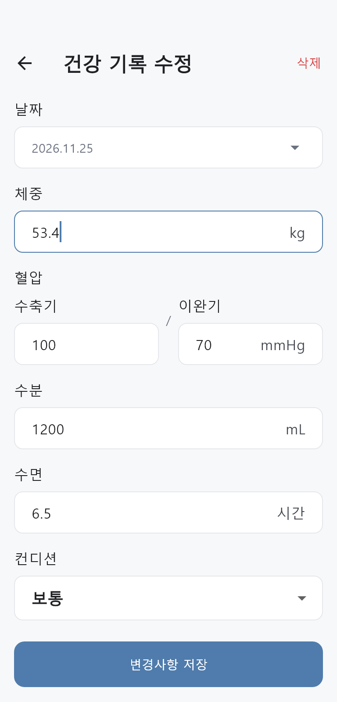
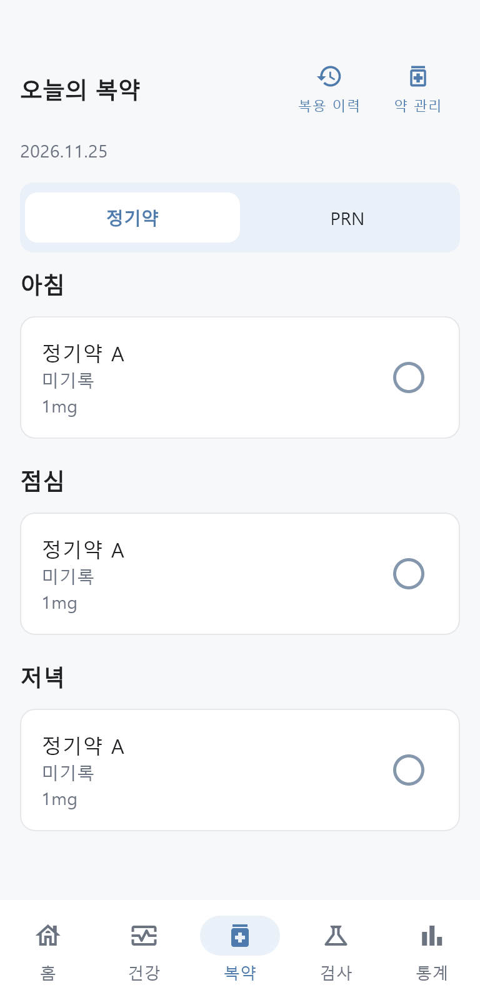
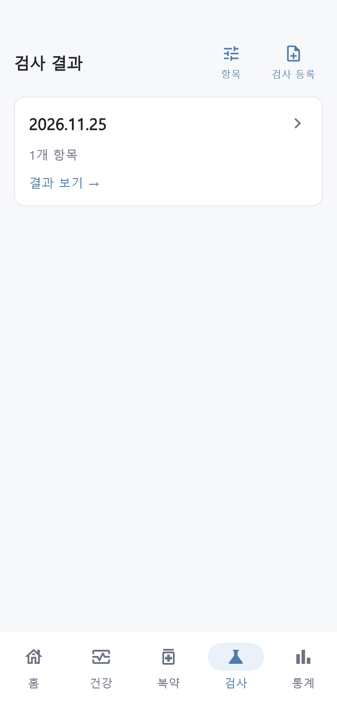
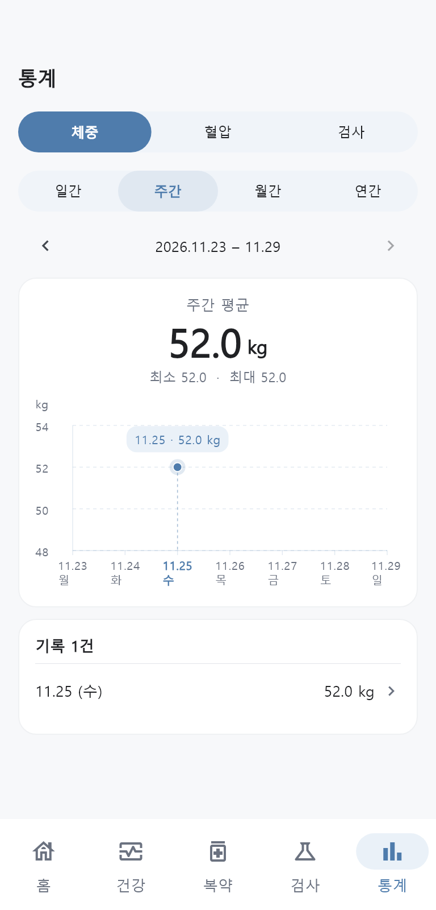
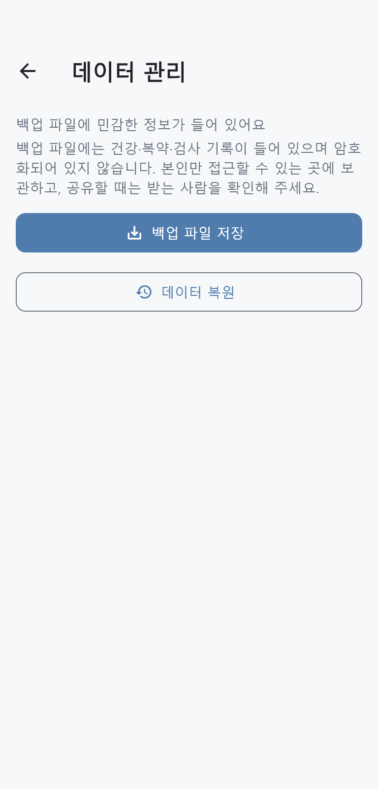

# My Health Log 사용 안내

3.21.2+66 · 2026-11-25 개정판

날짜별 건강·운동·복약·검사와 병원 일정을 기록하는 Android 앱입니다. 이 안내의 앱 화면은 합성 자료로 만든 예시입니다. 실제 개인 기록과 다르며 휴대폰의 글자 크기에 따라 배치가 달라질 수 있습니다.

## 1. 이번에 달라진 점

- 체중의 **사진/캡처로 입력** 버튼을 숨겼습니다. 체중계 모델과 캡처 양식에 따른 인식 차이를 보완하기 위한 조치입니다.
- 체중은 **건강 → 일상 기록 → 체중**에서 숫자를 직접 입력합니다. 기존 체중 기록과 통계는 그대로입니다.
- 처방·검사·병원 일정의 사진 입력은 계속 사용할 수 있습니다. 읽힌 값은 원본과 대조하고 필요한 부분을 고친 뒤 저장하세요.
- 실사용폰 SM-S918N과 테스트폰 SM-F936N에 같은 APK를 설치하고 기존 기록과 설정 보존을 확인했습니다.

설치는 [실제 화면 설치 안내](INSTALL.md)를 따르세요. 최신 파일은 [공개 다운로드 페이지](https://github.com/mydunalove-sena/my-health-log-releases/releases/latest)에서 확인합니다. 이번 개정판은 앱 버전 숫자가 이전3.21.2+66과 같으므로 배포일과 파일 확인값으로 구분합니다.

## 2. 홈에서 오늘과 지난 기록 보기

아래 메뉴는 **홈·건강·복약·검사·통계**입니다. 홈에서는 오늘의 기록과 복약 진행, 월간 기록을 살펴봅니다.

1. 달력에서 날짜를 눌러 해당 날짜의 기록을 확인하세요.
2. 지난달·다음 달로 이동해 조회할 수 있습니다. 달을 옮기는 것만으로 기록이 저장되지는 않습니다.
3. 병원 일정은 위쪽 **병원 일정**, 백업은 **데이터 관리**에서 엽니다.
4. 홈의 복약 진행률은 집계 설정의 영향을 받습니다. 실제 복용 내역은 복약 화면에서도 확인하세요.

## 3. 체중·혈압·수분·수면 기록하기

1. 아래 **건강**을 누르고 위쪽 **일상 기록**을 여세요.
2. **날짜**를 확인하세요. 같은 날짜에 기록이 있으면 기존 값이 표시됩니다.
3. 체중은 **kg** 단위의 숫자로 직접 입력하세요. 사진·인바디 캡처 등록 버튼은 이번 버전에 표시되지 않습니다.
4. 필요한 혈압·수분·수면·컨디션을 입력하고 아래 **저장** 또는 **변경사항 저장**을 누르세요.

체중 입력 범위는15~500kg이며 소수점 아래 두 자리까지 입력할 수 있습니다. 수면은0시간 초과~24시간입니다. 화면 아래 내용이 보이지 않으면 위로 밀어 스크롤하세요. **항목**에서 입력 항목을 숨겨도 이미 저장한 기록은 삭제되지 않습니다. 날짜를 바꾸거나 화면을 나갈 때 미저장 변경이 있으면 안내를 확인하세요.

## 4. 운동 기록하기

1. **건강 → 운동 기록**을 여세요.
2. 날짜·운동 종류·시간과 화면에서 제공하는 항목을 확인하세요.
3. 계산된 예상 소모 칼로리는 참고값입니다. 계산할 수 없는 경우 표시되는 안내를 확인하세요.
4. 저장 후 **운동** 목록에서 날짜와 내용을 확인하세요. 같은 날 여러 운동은 각각의 기록으로 보관됩니다.

기존 기록을 고치려면 해당 운동을 선택하세요. 새 운동과 기존 운동 수정을 구분하고, 삭제할 때는 대상 기록을 확인하세요.

## 5. 정기약 등록과 복용 체크

1. **복약 → 약 관리**에서 약을 등록하거나 기존 약을 선택하세요.
2. 약 이름·규격·복용량·단위·복용 시각을 실제 처방과 대조하세요.
3. 복약의 **정기약**에서 실제로 복용한 항목을 체크하세요. 시각을 보완할 때는 해당 기록의 시간 입력 기능을 사용하세요.
4. 과거 내역은 **복용 이력**에서 날짜를 확인하며 조회합니다. 빠진 기록은 **누락 복약 추가**로 입력합니다.

약별 **복용 알림**은 약 수정 화면에서 켭니다. 알림이 필요한 시각을 확인하고 휴대폰의 알림 권한을 허용하세요. 이미 복용 체크한 약은 해당 시각의 알림에서 생략될 수 있습니다. 알림은 실제 복용 여부를 자동으로 판정하지 않습니다.

## 6. 필요할 때 복용한 약 기록하기

**PRN**은 필요할 때 복용하는 약의 기록입니다.

1. 약 관리에서 필요 시 복용약의 정보와 단위를 확인하세요.
2. **복약 → PRN**에서 해당 약의 복용 기록을 입력하세요.
3. 실제 복용 날짜·시각·양을 확인한 뒤 저장하세요.
4. **복용 이력**에서 해당 날짜의 기록을 다시 확인할 수 있습니다.

복용량을 추측해 입력하지 말고 처방이나 약 봉투를 확인하세요. 기존 기록 수정과 새 복용 추가를 구분하세요.

## 7. 검사 선택과 결과 등록

1. **검사 → 항목**에서 **기록할 검사 선택**을 엽니다.
2. 검사명을 검색하거나 **진료과로 찾기**에서 후보를 좁힌 뒤 필요한 항목을 체크하세요.
3. **전체 선택·전체 선택 해제**는 지금 검색·필터에 보이는 목록에 적용됩니다. **체크한 항목만** 보기에서 선택을 점검할 수 있습니다.
4. **검사 → 검사 등록**에서 직접 입력 또는 사진 입력 방법을 선택하세요. 검사 날짜·검사명·결과·단위를 확인하고 저장하세요.

체크를 해제해도 과거 결과는 남습니다. 소변검사의 문자·기호 결과는 직접 입력하세요. 숫자 통계에는 숫자 결과만 사용됩니다. 이름이 비슷한 혈액·소변 항목과 서로 다른 단위를 구분하세요.

## 8. 처방·검사 사진으로 입력하기

- 처방은 **복약 → 약 관리 → 처방 캡처로 등록**에서 시작합니다.
- 검사는 **검사 → 검사 등록 → 사진으로 입력** 또는 **소변검사 사진으로 입력**에서 시작합니다.
- 사진 선택 후 읽힌 내용을 **원본 사진과 나란히 확인**하고 날짜·이름·수치·소수점·단위를 보완하세요.
- 원본 확인 항목과 저장 안내를 따른 뒤 목록에서 저장 결과를 다시 확인하세요.

OCR이 모든 병원·촬영 상태·양식을 정확하게 읽는 것은 아닙니다. 읽히지 않은 값은 원본을 보며 직접 보완하세요. 이번 버전의 체중 사진 입력은 숨김 상태입니다.

## 9. 병원 일정과 알림

1. **홈 → 병원 일정**을 여세요.
2. 직접 입력하거나 예약 캡처를 확인해 일정을 등록하세요.
3. 날짜·시각·병원·진료과를 원본 예약과 대조하세요. 알림이 필요하면 날짜와 시각을 지정하세요.
4. 저장 후 목록과 상세를 확인하세요. 홈에는 가까워진 일정이 표시됩니다.

정확한 알람 권한이 없다는 안내가 나오면 안내의 설정 버튼을 확인하세요. 휴대폰의 알림 권한·절전 설정·OS에 따라 알림이 제한되거나 늦어질 수 있습니다. 예약 시각은 병원 안내에서도 확인하세요.

## 10. 통계에서 기록 흐름 보기

**통계**에서 체중·혈압·검사 항목을 선택하고 조회 기간을 확인하세요. 그래프의 날짜와 단위, 실제 입력한 값을 함께 살펴보세요. 기록이 없는 날짜에 새 값이 자동으로 만들어지는 것은 아닙니다.

검사 단위가 다르거나 숫자가 아닌 결과는 같은 숫자 추이로 임의 연결되지 않을 수 있습니다. eGFR은 앱 계산에 따른 추정값입니다. 통계는 진단이나 처방 변경을 위한 자동 판정이 아닙니다.

## 11. 백업·복원과 휴대폰 교체

1. **홈 → 데이터 관리 → 백업 파일 저장**을 누르세요.
2. 저장 창에서 위치와 파일명을 확인하고 **저장**하세요.
3. 백업에는 개인 건강 기록이 포함되며 암호화되어 있지 않습니다. 본인만 접근할 수 있는 곳에 보관하세요.
4. 휴대폰을 바꾸면 새 기기의 앱에서 **데이터 복원**으로 파일을 선택하고 확인 내용을 읽은 뒤 진행하세요.

복원은 현재 기록을 바꾸는 작업이므로 먼저 현재 기기의 새 백업을 보관하세요. 이 앱의 Android 클라우드 자동 백업과 기기 간 자동 전송은 꺼져 있습니다. 직접 저장한 백업을 별도로 옮겨야 합니다. 앱 삭제나 휴대폰 초기화로 문제를 해결하려 하지 마세요.

## 12. 저장 실패·설치 문제·도움 요청

- 저장·삭제 실패 안내가 나오면 성공한 것으로 생각하지 말고 현재 입력값과 목록을 확인한 뒤 재시도하세요.
- 목록을 불러오지 못했다면 화면의 재시도 기능을 사용하세요. 빈 목록 표시와 불러오기 실패는 다릅니다.
- 글씨가 크면 화면을 스크롤해 아래 버튼을 확인하세요. 휴대폰의 글자 크기 설정을 사용할 수 있습니다.
- 설치되지 않거나 기존 기록이 보이지 않으면 앱과 백업을 보관한 채 제작자에게 버전·발생 화면·조작 순서를 알려 주세요.
- 도움을 받을 때 개인 백업·처방·검사 사진을 공개 GitHub 게시글에 올리지 마세요.

[설치 안내](INSTALL.md) · [이번 개정판과 확인 범위](RELEASE_NOTES_2026-11-25.md) · [다운로드·문서 목록](README.md)
